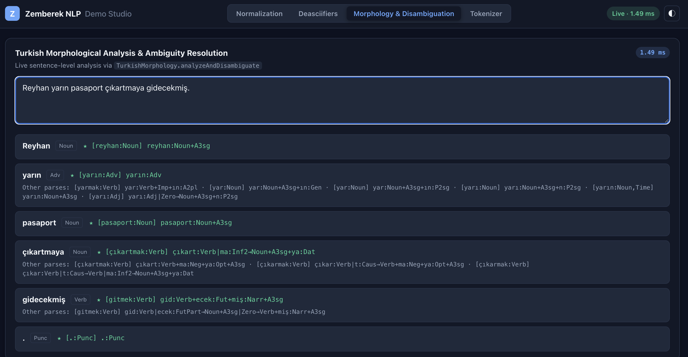

Zemberek-NLP
============

**This project is now in slow maintenance mode.**

Zemberek-NLP provides Natural Language Processing tools for Turkish.

Latest version is 0.20.1. [Change Log](CHANGELOG.md)

Please read the [FAQ](https://github.com/ahmetaa/zemberek-nlp/wiki/FAQ) for common questions.

## Modules

|  Module    | Maven Id |         |
|------------|----------|---------|
| [Core](core)                    | zemberek-core           | Special Collections, Hash functions and helpers. |
| [Morphology](morphology)        | zemberek-morphology     | Turkish morphological analysis, disambiguation and word generation. |
| [Tokenization](tokenization)    | zemberek-tokenization   | Turkish tokenization, detokenization and sentence boundary detection. |
| [Normalization](normalization)  | zemberek-normalization  | Spell checker, deasciifier (`LatticeDeasciifier`), and noisy text normalization. |
| [NER](ner)                      | zemberek-ner            | Turkish Named Entity Recognition. |
| [Classification](classification)| zemberek-classification | Text classification based on Java port of fastText project. |
| [Language Identification](lang-id)| zemberek-lang-id      | Fast identification of text language. |
| [Language Modeling](lm)         | zemberek-lm             | Provides a language model compression algorithm. |
| [Applications](apps)            | zemberek-apps           | Console applications and interactive Web Demo Studio (`StartWebDemo`). |
| [gRPC Server](grpc)             | zemberek-grpc           | gRPC server for access from other languages. |
| [Examples](examples)            | zemberek-examples       | Usage examples. |

## Interactive Web Demo Studio

You can explore morphological analysis, ambiguity resolution, noisy text normalization, deasciification, and tokenization interactively with `StartWebDemo` (`./apps/run_demo.sh`):



## Usage

### Maven

Add this to pom.xml file

```xml
    <repositories>
        <repository>
            <id>zemberek-repo</id>
            <name>zemberek Maven Repo on Github</name>
            <url>https://raw.github.com/ahmetaa/maven-repo/master</url>
        </repository>
    </repositories>
```

And dependencies (For example morphology):

```xml
    <dependencies>
        <dependency>
            <groupId>zemberek-nlp</groupId>
            <artifactId>zemberek-morphology</artifactId>
            <version>0.20.1</version>
        </dependency>
    </dependencies>
```

### Jar distributions

[Google drive page](https://drive.google.com/#folders/0B9TrB39LQKZWSjNKdVcwWUxxUm8) contains jar files for different versions. 

[**zemberek-full.jar**] is a single jar that contains all modules and dependencies.
When it is run directly with 
      
      java -jar zemberek-full.jar

It will list available console applications.  

### Docker

A `Dockerfile` is provided that builds `zemberek-full.jar` from source and packages it in a
Java 21 runtime image:

    docker build -t zemberek .

By default the container starts the [gRPC server](grpc) on port 6789:

    docker run -p 6789:6789 zemberek

Any other console application can be run by passing its name and parameters. For example, the
web demo (open http://localhost:8080) or the interactive morphology console:

    docker run -p 8080:8080 zemberek StartWebDemo --host 0.0.0.0
    docker run -it zemberek MorphologyConsole

To list available applications:

    docker run --rm --entrypoint java zemberek -jar /app/zemberek-full.jar

The JVM heap defaults to 75% of the container memory limit. It can be changed through
`JAVA_TOOL_OPTIONS`, e.g. `docker run -e JAVA_TOOL_OPTIONS="-Xmx2g" ...`.

### For Developers 

[Here](https://github.com/ahmetaa/zemberek-nlp/wiki/Zemberek-For-Developers) information about 
how to compile the code and generate jar files from the project is explained. 

### Examples

There is an [examples](examples) module in the code for usage examples.

Also, there is a separate project with same examples that uses Zemberek-NLP as maven modules: 
[Turkish-nlp-examples](https://github.com/ahmetaa/turkish-nlp-examples)

## Known Issues and Limitations
- NER module does not provide a model yet.
- Library is not well-tested for multi-threaded usage.

Please see issues section for further issues and feel free to create new ones.

## License
Code is licensed under Apache License, Version 2.0

## Citing

If you use this project in an academic publication, please refer to this site.

## Acknowledgements
Please refer to contributors.txt file.
