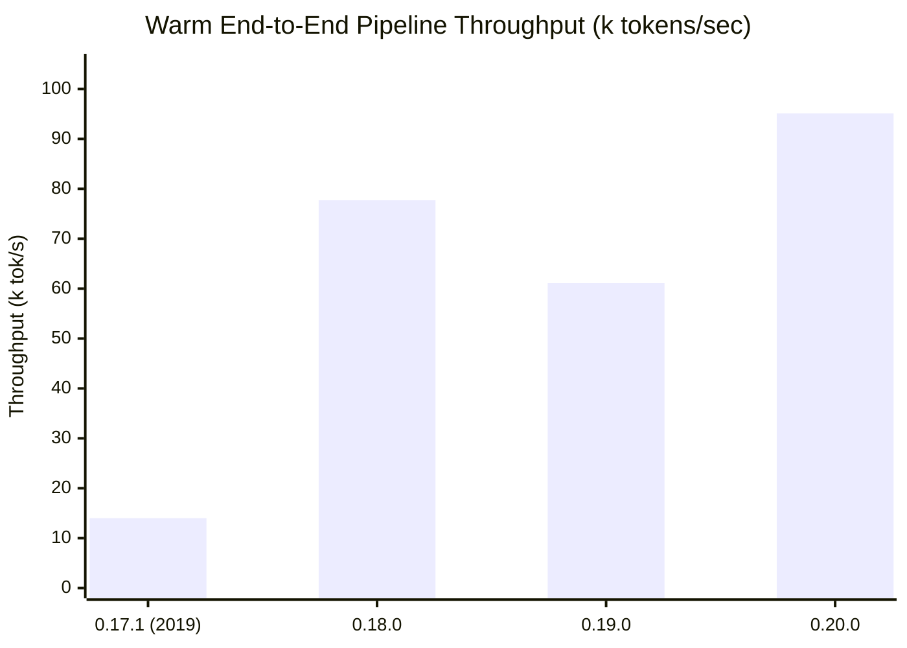
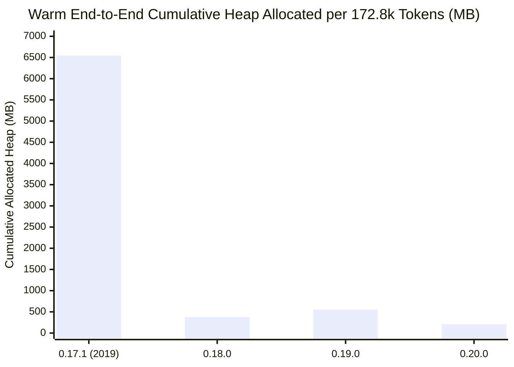

# Zemberek-NLP Modernization Report (`0.17.1` → `0.20.0`)

After a seven-year hiatus following `0.17.1` (July 2019), Zemberek-NLP underwent a rapid LLM-assisted modernization in November 2026—delivering **three releases (`0.18.0`, `0.19.0`, `0.20.0`) across 108 merged PRs in under three weeks**.

> [!IMPORTANT]
> **Headline Impact (`0.17.1` → `0.20.0`, single-threaded on the same JVM & corpus):**
> - **End-to-End Pipeline Speed:** **4.2× faster** (cold cache) and **6.8× faster** (warm cache: `14.0k → 95.1k tok/s`).
> - **Heap Allocation Churn:** **-95% to -98% fewer bytes allocated** (`6.5 GB → 214 MB` warm E2E; `10 → 0` GC pauses).
> - **Disambiguation:** **10× faster** (`19.1k → 191.1k tok/s`), **-98.3% allocations**, and major accuracy gains (cutting legacy errors by ~68% in `0.18.0`, then another **-11.8%** in `0.20.0`).
> - **Modern Turkish & Normalization:** Audited 2020–2026 lexicon with multi-pronunciation support, new **Lattice Deasciifier** (`~95%–97%` sentence accuracy), new **Span-Lattice Perceptron Normalizer** (`81%–90%` word error reduction), zero-setup bundled models, and an interactive **Web Demo Studio**.

---

## 1. Release Highlights at a Glance

| Release | Date | PRs | Core Theme & Key Changes |
| :--- | :--- | ---: | :--- |
| **`0.17.1`** | Jul 2019 | — | Last pre-hiatus release (Java 8 baseline, legacy perceptron disambiguator, external normalization files). |
| **`0.18.0`** | Nov 10, 2026 | 36 | **Platform & Disambiguator Overhaul**: Upgraded baseline to **Java 21** + modern dependencies; replaced legacy disambiguator with `FastPerceptronAmbiguityResolver` (exact Viterbi, compact `2.16 MB` model, ~4× faster, ~68% fewer errors); retrained sentence boundary model & improved tokenizer; unified 50k Caffeine analysis cache; cut `UNK` tokens by 45% on news corpora. |
| **`0.19.0`** | Nov 18, 2026 | 51 | **Normalization, Deasciification & Usability**: Introduced `SpanLatticePerceptronNormalizer` (Semi-Markov `1:1`/`1:2`/`2:1` lattice normalizer) and `LatticeDeasciifier` (with `CircumflexMode`); bundled all default normalization/deasciification models for zero-setup `createWithDefaults()`; added informal Turkish morphotactics, `TurkishDetokenizer`, Unicode emoji support, lazy disambiguator loading, and the interactive **Web Demo Studio** (`StartWebDemo`). |
| **`0.20.0`** | Nov 25, 2026 | 21 | **Lexicon Modernization, Accuracy & Allocation Efficiency**: Comprehensive dictionary audit + 2020–2026 Turkish vocabulary/entities + multiple alternative pronunciations per entry; upgraded disambiguation model (`model_15k_v25.bin`, `-11.8%` fewer ambiguous errors); parent-linked `SearchPath`, zero-alloc multi-part MPHF hashing, single-pass `TextUtil` scanners, unified `StemTransitionsMapBased`, and modularized `TurkishMorphotactics`. |

---

## 2. End-to-End Pipeline Comparison (`0.17.1` → `0.20.0`)

Measured single-threaded on the exact same machine, JVM (`OpenJDK 21`, `-Xms1g -Xmx1g`), and bundled Turkish prose corpus (`Sentence-Boundary-Train.txt` + `Sentence-Boundary-Test.txt`: **2,071 paragraphs / 10,404 sentences / ~172,800 tokens / 41,315 unique types**).

| Metric *(per 172.8k-token pass)* | `0.17.1` | `0.18.0` | `0.19.0` | **`0.20.0`** | **`0.17.1 → 0.20.0`** |
| :--- | :---: | :---: | :---: | :---: | :--- |
| **E2E Pipeline — Cold Cache** *(segment → tokenize → analyze → disambiguate)* | `13.1k tok/s` `6,762 MB` (`40.1 KB/tok`) `11` GC pauses (`136 ms`) | `38.5k tok/s` `863 MB` (`5.1 KB/tok`) `1` GC pause (`49 ms`) | `40.3k tok/s` `899 MB` (`5.3 KB/tok`) `1` GC pause (`44 ms`) | **`55.4k tok/s`** **`363 MB`** (`2.1 KB/tok`) **`0` GC pauses (`0 ms`)** | **4.2× faster** **-94.6% allocs** (`18.6×` less) `11 → 0` GC pauses |
| **E2E Pipeline — Warm Cache** *(segment → tokenize → analyze → disambiguate)* | `14.0k tok/s` `6,548 MB` (`38.8 KB/tok`) `10` GC pauses (`36 ms`) | `77.7k tok/s` `379 MB` (`2.2 KB/tok`) `0` GC pauses (`0 ms`) | `61.1k tok/s`\* `550 MB` (`3.3 KB/tok`) `0` GC pauses (`0 ms`) | **`95.1k tok/s`** **`214 MB`** (`1.3 KB/tok`) **`0` GC pauses (`0 ms`)** | **6.8× faster** **-96.7% allocs** (`30.6×` less) `10 → 0` GC pauses |
| **E2E Pipeline — Uncached Analysis**\* | `11.3k tok/s` `8,320 MB` (`49.3 KB/tok`) `13` GC pauses (`48 ms`) | `27.3k tok/s` `1,873 MB` (`11.1 KB/tok`) `3` GC pauses (`61 ms`) | `29.1k tok/s` `1,899 MB` (`11.3 KB/tok`) `3` GC pauses (`47 ms`) | **`44.5k tok/s`** **`755 MB`** (`4.5 KB/tok`) **`1` GC pause (`8 ms`)** | **3.9× faster** **-90.9% allocs** (`11.0×` less) `-83%` GC pause time |
| **Morphological Analysis Only (Uncached)**\* | `34.1k tok/s` `2,365 MB` (`14.0 KB/tok`) `3` GC pauses | `46.4k tok/s` `1,500 MB` (`8.9 KB/tok`) `2` GC pauses | `48.1k tok/s` `1,497 MB` (`8.9 KB/tok`) `2` GC pauses | **`71.2k tok/s`** **`606 MB`** (`3.6 KB/tok`) **`0` GC pauses (`0 ms`)** | **2.1× faster** **-74.4% allocs** (`3.9×` less) `3 → 0` GC pauses |
| **Disambiguation Only (Warm Resolver)** | `19.1k tok/s` `5,859 MB` (`34.7 KB/tok`) `9` GC pauses (`36 ms`) | `118.1k tok/s` `289 MB` (`1.7 KB/tok`) `0` GC pauses (`0 ms`) | `134.3k tok/s` `318 MB` (`1.9 KB/tok`) `0` GC pauses (`0 ms`) | **`191.1k tok/s`** **`98 MB`** (`0.6 KB/tok`) **`0` GC pauses (`0 ms`)** | **10.0× faster** **-98.3% allocs** (`59.8×` less) `9 → 0` GC pauses |
| **Retained Live Heap (Idle / Warm Caches)** | `52.8 MB` / `64.7 MB` | `69.5 MB` / `167.6 MB` | `54.1 MB` / `122.0 MB` | **`56.2 MB` / `155.6 MB`** | Near-flat idle (`+3.4 MB`); bounded warm caches |
| **Benchmark Corpus Parse Coverage** | `99.01%` (`1,704` UNK) | `99.10%` (`1,560` UNK) | `99.09%` (`1,565` UNK) | **`99.16%` (`1,443` UNK)** | **-15.3%** fewer `UNK` tokens |

> [!NOTE]
> \* **Methodology Notes:**
> - In `0.17.1`, `TurkishMorphology.analyze(Token)` threw an NPE when `disableCache()` was enabled; uncached `0.17.1` runs used `analyze(String)` as a fallback (the bug was fixed in `0.18.0`).
> - In `0.19.0`, resolver caches were tightened to reduce steady-state RAM (`167.6 MB → 122.0 MB`), slightly lowering warm throughput on 172k tokens; `0.20.0` recovered and surpassed `0.18.0` via 2-way L1 caches and zero-alloc feature hashing while staying below `0.18.0`'s heap footprint (`155.6 MB`).
> - Cumulative allocations are exact thread-allocated bytes via `ThreadMXBean.getThreadAllocatedBytes`; GC stats via `GarbageCollectorMXBean`; live heap measured post-GC.

---

## 3. Morphological Disambiguation Accuracy

Disambiguation accuracy improved in two major steps—first replacing the legacy `0.17.1` model with exact Viterbi decoding in `0.18.0`, then expanding training data to `14,935` sentences (including `5,000` modern 2020–2026 sentences) in `0.20.0`:

| Upgrade Step | Held-Out Benchmark | Ambiguous Words | All Tokens | Exact-Match Sentences | Relative Error Reduction |
| :--- | :--- | :---: | :---: | :---: | :--- |
| **`0.17.1` → `0.18.0`** | 1,000 sentences (`6,587` ambiguous tokens) | `77.5%` → **`92.8%`** | `86.8%` → **`95.6%`** | **~2.7×** more exact sentences | **~68% fewer errors** |
| **`0.19.0` → `0.20.0`** | 1,991 sentences (`13,102` ambiguous / `23,200` total, [#401](https://github.com/ahmetaa/zemberek-nlp/pull/401)) | `91.68%` → **`92.67%`** | `95.30%` → **`95.86%`** | `59.67%` → **`63.13%`** (`+3.46%`) | **-11.8% fewer ambiguous errors** |

---

## 4. New Normalization & Deasciification Results (`0.19.0+`)

Both subsystems were redesigned in `0.19.0` and ship with **zero-external-setup bundled models** (`createWithDefaults()`).

### 4.1 Turkish Deasciifier: Legacy `Deasciifier` vs. `LatticeDeasciifier` ([#345](https://github.com/ahmetaa/zemberek-nlp/pull/345), [#346](https://github.com/ahmetaa/zemberek-nlp/pull/346))

`LatticeDeasciifier` uses a morphological candidate lattice with 2-pass bidirectional Viterbi refinement, a compact `3.58 MiB` bundled model, `~325k–350k tok/s` warm throughput, and configurable `CircumflexMode` (`DISAMBIGUATION_ONLY` default, `NONE`, `FULL`).

| Evaluation Suite | Sentences | Legacy Sent (`No^`) | `LatticeDeasciifier` Sent (`No^`) | Legacy Word (`No^`) | `LatticeDeasciifier` Word (`No^`) |
| :--- | ---: | :---: | :---: | :---: | :---: |
| **Gemini-2500** *(Gold Clean Diverse)* | 2,500 | 83.76% | **94.88%** (`+11.12%`) | 98.52% | **99.57%** |
| **Refined-Test Verified-Clean** | 12,169 | 89.28% | **96.38%** (`+7.10%`) | 99.00% | **99.69%** |
| **Held-Out News & Economy** | 2,500 | 89.60% | **97.32%** (`+7.72%`) | 99.08% | **99.79%** |
| **Held-Out Wiki, Science & Legal** | 2,500 | 86.60% | **95.80%** (`+9.20%`) | 98.88% | **99.66%** |
| **Homograph Minimal Pairs** | 100 | 56.00% | **75.00%** (`+19.00%`) | 93.87% | **96.81%** |
| **Partial-ASCII Non-Destructive** | 500 | 80.60% *(12 stripped)* | **96.80%** *(**0 stripped**)* | 98.31% | **99.74%** |
| **Foreign, Acronyms & Spans** | 36 | 58.33% | **97.22%** (`+38.89%`) | 94.22% | **99.64%** |

### 4.2 Noisy Text Normalization: Legacy vs. `SpanLatticePerceptronNormalizer` ([#381](https://github.com/ahmetaa/zemberek-nlp/pull/381), [#383](https://github.com/ahmetaa/zemberek-nlp/pull/383))

`SpanLatticePerceptronNormalizer` performs joint Semi-Markov Viterbi decoding over `1:1` rewrites, `1:2` clitic/compound splits, and `2:1`/`3:1` merges with contextual truecasing and punctuation preservation (`~13,000 tok/s` single-threaded, `2.62 MB` quantized perceptron weights).

| Held-Out Suite (5,000 sents each) | Baseline Word Error Reduction | `SpanLatticePerceptronNormalizer` WER Reduction | Notes |
| :--- | :---: | :---: | :--- |
| **Heavy Multi-Noise (`test_slice_01`)** | 61.82% | **80.79%** (`+18.97%`) | `68.60%` exact sentence match; `1.55%` clean false-positive rate |
| **Social Media (`nasty_5k`)** | 80.98% | **90.41%** (`+9.43%`) | Bundled `knowledge.bin.gz` + `perceptron.bin.gz`, zero external files |

---

## 5. Summary of Engineering Modernization

- **Java 21 & Clean Dependencies**: Migrated from Java 8 (`0.17.1`) to Java 21, upgraded `Guava`, `Protobuf`, `Caffeine`, `gRPC`, and `OpenNLP`, and dropped legacy/deprecated server code.
- **Zero-Setup Developer Experience**: Bundled normalization, deasciification, and disambiguation models directly in module JARs (`createWithDefaults()`), added `TurkishTokenizer.detokenize(...)`, Unicode emoji support, and a built-in **Web Demo Studio**.
- **Maintainable Architecture**: Modularized the 2,607-line `TurkishMorphotactics` class into focused domain modules, added `LexiconIntegrityTest`, and kept all `0.20.0` performance improvements simple and readable (parent-linked `SearchPath`, zero-alloc multi-part MPHF hashing, single-pass `TextUtil`, unified `StemTransitionsMapBased`).
