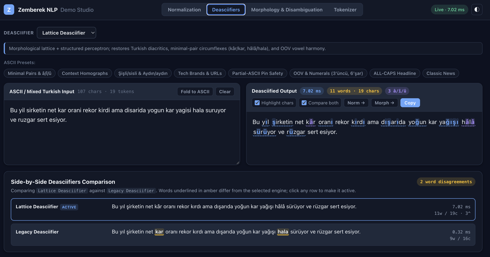

Turkish Text Normalization
============

  * [Turkish Spell Checker](#turkish-spell-checker)
  * [Spelling Suggestion](#spelling-suggestion)
    + [Limitations](#limitations)
  * [Turkish Deasciifier (`LatticeDeasciifier`)](#turkish-deasciifier-latticedeasciifier)
  * [Noisy Text Normalization](#noisy-text-normalization)
    + [Usage (`TurkishSentenceNormalizer`)](#usage-turkishsentencenormalizer)
    + [Speed](#speed)
    + [Limitations](#limitations-1)

## Turkish Spell Checker

Spell checker provides methods for checking if a word is correctly written and can give suggestions for a word.
TurkishSpellChecker class is used for this.

 
Instantiation:

    TurkishMorphology morphology = TurkishMorphology.createWithDefaults();
    TurkishSpellChecker spellChecker = new TurkishSpellChecker(morphology);

After this, several methods are available. _check(String input)_ method is used for 
 detecting if a word is spelled correctly.
 
    String[] words = {"okuyabileceğimden","okuyablirim", "Ankara", "Ankar'ada", "3'de", "3'te"};
    for (String word : words) {
        System.out.println(word + " = " + spellChecker.check(word));
    } 

Output will be

    okuyabileceğimden = true
    okuyablirim = false
    Ankara = true
    Ankar'ada = false
    3'de = false
    3'te = true

## Spelling Suggestion

Currently Zemberek provides a simple suggestion mechanism.

For getting suggestions for incorrect words suggestForWord method can be used:

    String[] words = {"okuyablirim", "tartısıyor", "Ankar'ada", "knlıca"};
    for (String word : words) {
        System.out.println(word + " = " + spellChecker.suggestForWord(word));
    } 
    
Will give these suggestions:
    
    okuyablirim = [okuyabilirim]
    tartısıyor = [tartışıyor, tartılıyor, tartınıyor]
    Ankar'ada = [Ankara'da, Ankara'ya, Ankara'dan, Ankaray'da, Ankara'ma, Antara'da, Ankara'ca, Cankara'da, Anakarada, Ankara'na, Angara'da, Ankara'mda, Ankara'nda, Ankaray'a]
    knlıca = [Kanlıca, kanlıca, In'lıca, kılıca, anlıca, Kanlı'ca, kınlıca, kalıca]

If user provides a higher order language model (bi-gram models are sufficient) and context words, ranking of the suggestions may improve. Method below is used for this. 

```java
    public List<String> suggestForWord(
                String word,
                String leftContext,
                String rightContext,
                NgramLanguageModel lm)
```
    
### Limitations

 - It only may correct for 1 insertion, 1 deletion, 1 substitution and 1 transposition errors.
 - It ranks the results with an internal unigram language model (unless a context LM is supplied).
 - It does not correct numbers, dates and times.
 - There may be junk results.
 - For shorter words, there will be a lot of suggestions (sometimes >50 ).
 - Suggestion function is not so fast (Around 500-1000 words/second).

## Turkish Deasciifier (`LatticeDeasciifier`)



`LatticeDeasciifier` restores Turkish diacritics (`ç, ğ, ı, İ, ö, ş, ü` and circumflex vowels `â, î, û`) on ASCII-typed or partially diacritized Turkish text using a 3-stage pipeline:
1. **Morphological Candidate Lattice**: Combines strict/informal/diacritic-tolerant morphological analysis, lexicon confusion priors, and a character harmony model.
2. **Pass-1 Trigram Beam Search**: Left-to-right Viterbi beam search (`beamWidth = 4`) with agglutinative stem lookahead.
3. **Pass-2 Bidirectional Refinement**: Right-to-left (head-final SOV) and left-to-right coordinate sweeps using wide content-word context.

### Usage

```java
TurkishMorphology morphology = TurkishMorphology.createWithDefaults();
LatticeDeasciifier deasciifier = LatticeDeasciifier.createWithDefaults(morphology);

String input = "Ruzgar sert esiyor ama hala disarida yuruyus yapan insanlar var.";
System.out.println(deasciifier.deasciify(input));
// Output: Rüzgar sert esiyor ama hâlâ dışarıda yürüyüş yapan insanlar var.
```

Circumflex insertion behavior can be configured via `CircumflexMode` (`DISAMBIGUATION_ONLY` is the default, restoring circumflexes on minimal pairs such as *kâr/kar* and *hâlâ/hala*; `NONE` and `FULL` are also available):

```java
LatticeDeasciifier noCirc = deasciifier.withCircumflexMode(LatticeDeasciifier.CircumflexMode.NONE);
```

## Noisy Text Normalization


Zemberek-NLP offers noisy text normalization for correcting misspelled words, ASCII-typed text, split/merged words, and informal speech in noisy Turkish texts. Some noisy text examples:

    Yrn okua gidicem
    Tmm, yarin havuza giricem ve aksama kadar yaticam :)    
    ah aynen ya annemde fark etti siz evinizden çıkmayın diyo
    gercek mı bu? Yuh! Artık unutulması bile beklenmiyo   
    Hayır hayat telaşm olmasa alacam buraları gökdelen dikicem.
    yok hocam kesınlıkle oyle birşey yok
    herseyi soyle hayatında olmaması gerek bence boyle ınsanların falan baskı yapıyosa
    
Some NLP tasks need normalization as a pre-processing step before applying downstream algorithms:

- Social media and forum texts
- Chat, messaging or bot applications
- Mobile phone keyboards with no or poor spell correction

### Usage (`TurkishSentenceNormalizer`)

All default normalization and language models (`knowledge.bin.gz`, `perceptron.bin.gz`, and `lm.2gram.slm.gz`) are bundled inside `zemberek-normalization` — no external files need to be downloaded.

`TurkishSentenceNormalizer` is backed by `SpanLatticePerceptronNormalizer`, a joint Semi-Markov Averaged Perceptron normalizer operating over a multi-span candidate DAG (`1:1` rewrites, `1:2` clitic/compound splits, and `2:1`/`3:1` merges) while preserving casing and punctuation:

```java
TurkishMorphology morphology = TurkishMorphology.createWithDefaults();
TurkishSentenceNormalizer normalizer =
    TurkishSentenceNormalizer.createWithDefaults(morphology);

System.out.println(normalizer.normalize("Slm bugun geliyomusun?"));
// Output: Selam bugün geliyor musun?
```

If you want to load custom external model files (`knowledge.bin(.gz)`, `perceptron.bin(.gz)`, and `lm.2gram.slm`) instead of the bundled resources:

```java
Path modelDir = Paths.get("/path/to/v2-models");
Path lmFile = Paths.get("/path/to/lm.2gram.slm");
TurkishMorphology morphology = TurkishMorphology.createWithDefaults();
TurkishSentenceNormalizer normalizer =
    TurkishSentenceNormalizer.fromDirectory(morphology, modelDir, lmFile);
```

`SpanLatticePerceptronNormalizer` can also be used directly when you need access to the underlying lattice and arc scores (`SpanLatticePerceptronNormalizer.createWithDefaults(morphology)`).

Results for the example sentences above:

    Tmm, yarin havuza giricem ve aksama kadar yaticam :)
    Tamam, yarın havuza gireceğim ve akşama kadar yatacağım :)

    ah aynen ya annemde fark etti siz evinizden çıkmayın diyo
    ah aynen ya annemde fark etti siz evinizden çıkmayın diyor

    gercek mı bu? Yuh! Artık unutulması bile beklenmiyo
    gerçek mi bu? Yuh! Artık unutulması bile beklenmiyor

    yok hocam kesınlıkle oyle birşey yok
    yok hocam kesinlikle öyle bir şey yok

### Speed

Single-threaded throughput is approximately **13,000 tokens/second** with a `2.62 MB` quantized perceptron feature table.

### Limitations

Normalization is statistical and context-dependent:
- It may occasionally alter rare out-of-vocabulary words or domain-specific slang.
- Severe multi-edit typos outside the candidate lattice may remain uncorrected.

 
